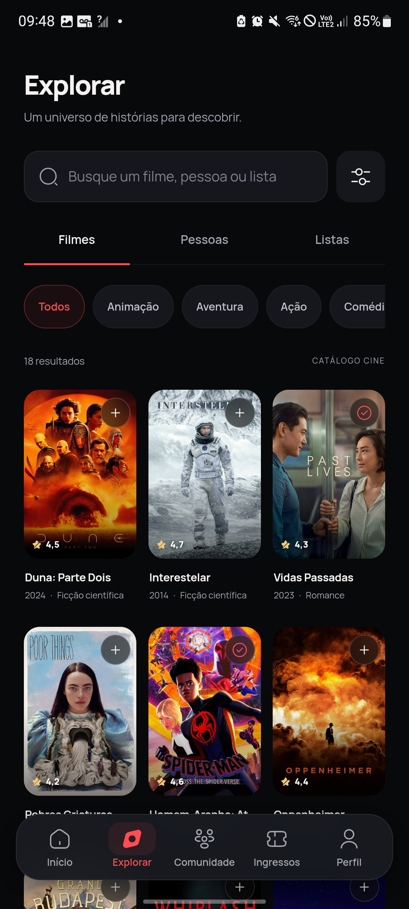
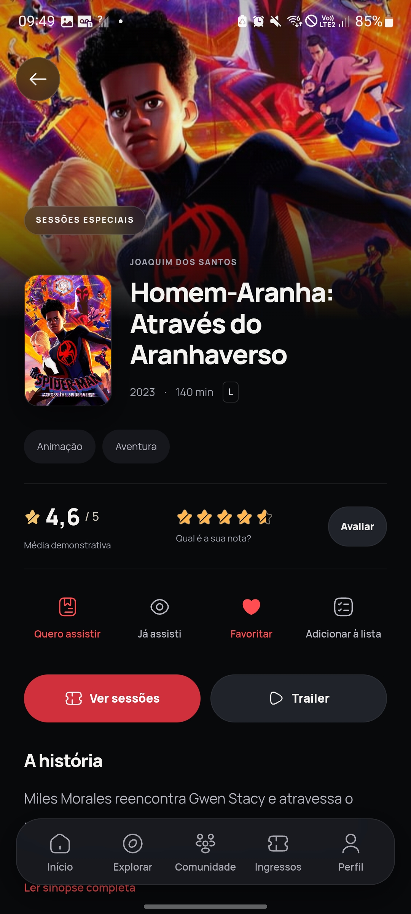
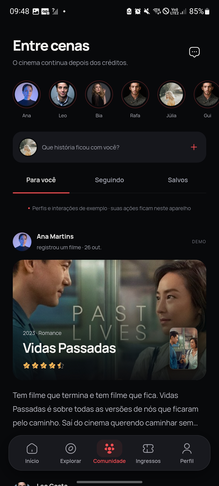
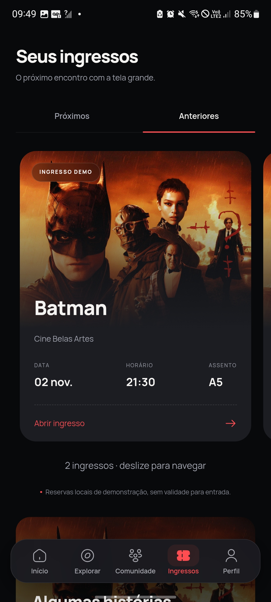
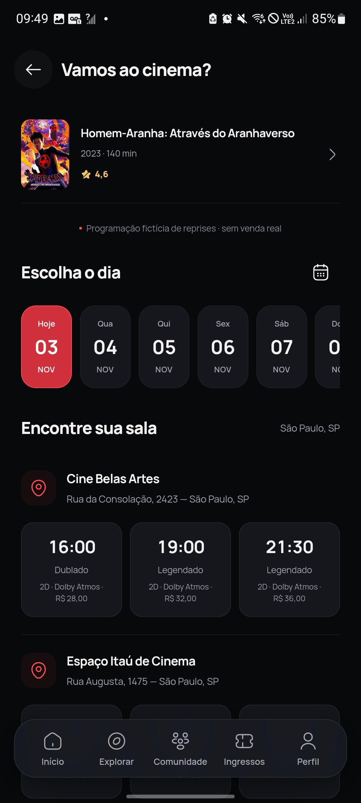
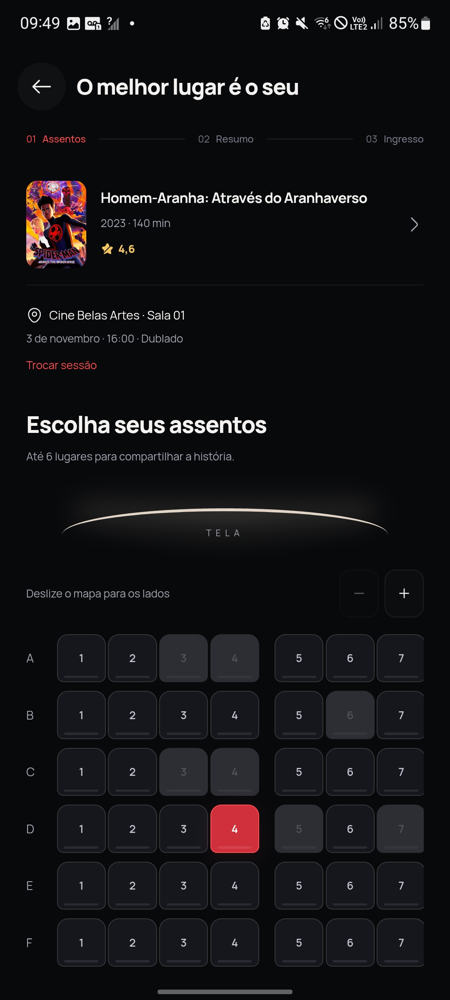
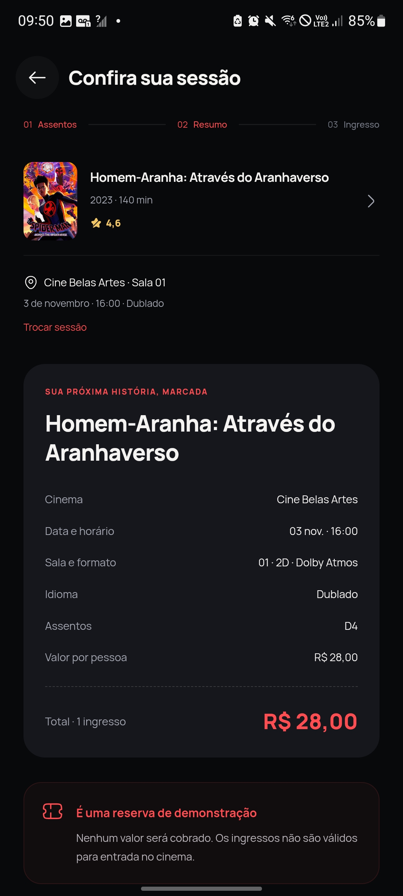

# Cine

**Sua próxima história começa aqui.**

Um app de cinema para descobrir filmes, guardar favoritos, compartilhar opiniões e explorar a experiência de reservar uma sessão. Disponível para Android e navegador, com interface em português, tema escuro e animações suaves.

[**Baixar APK para Android**](https://github.com/Eduardo39eir/app-cinema/releases/download/v1.1.0/Cine-1.1.0.apk) · [Todas as versões](https://github.com/Eduardo39eir/app-cinema/releases) · [Galeria de telas](#galeria-de-telas)

<p align="center">
  <a href="docs/screenshots/inicio.jpg"></a>
  &nbsp;
  <a href="docs/screenshots/explorar.jpg"></a>
  &nbsp;
  <a href="docs/screenshots/filme.jpg"></a>
</p>

<p align="center"><sub>Início · Explorar · Detalhes do filme — capturas reais do app Android. Clique nas imagens para ampliar.</sub></p>

## O que você pode fazer

- **Descobrir filmes:** catálogo com 18 títulos, recomendações por preferências, busca e filtros.
- **Registrar sua experiência:** notas, comentários, favoritos, filmes assistidos e listas personalizadas.
- **Explorar a comunidade:** feed, avaliações, perfis e conversas de demonstração.
- **Planejar uma sessão:** escolher cinema, dia, horário e assentos em uma reserva demonstrativa.
- **Guardar ingressos:** consultar o histórico, visualizar o QR e exportar o ingresso.
- **Personalizar seu espaço:** editar perfil, avatar e capa, ajustar contraste e reduzir movimento.

Os dados ficam salvos no aparelho ou navegador. No computador, a interface aparece dentro de uma prévia interativa de iPhone; no celular, ocupa a tela diretamente.

## Galeria de telas

### Seu universo cinematográfico

Comunidade, perfil e histórico de ingressos em um só lugar.

<p align="center">
  <a href="docs/screenshots/comunidade.jpg"></a>
  &nbsp;
  <a href="docs/screenshots/perfil.jpg"></a>
  &nbsp;
  <a href="docs/screenshots/historico-ingressos.jpg"></a>
</p>

### Da escolha da sessão ao ingresso

Escolha o horário, encontre seu assento, confira os detalhes e receba um ingresso com QR.

<p align="center">
  <a href="docs/screenshots/sessoes.jpg"></a>
  <a href="docs/screenshots/assentos.jpg"></a>
  <a href="docs/screenshots/resumo.jpg"></a>
  <a href="docs/screenshots/ingresso.jpg"></a>
</p>

<details>
<summary>Ver também: tela de ingressos antes da primeira reserva</summary>

<p align="center">
  <a href="docs/screenshots/ingressos-vazio.jpg"></a>
</p>

</details>

## Instalar no Android

[**⬇ Baixar Cine 1.1.0 — APK**](https://github.com/Eduardo39eir/app-cinema/releases/download/v1.1.0/Cine-1.1.0.apk)

Android 7 ou superior · 7,2 MB.

1. Abra o link no celular e baixe o APK.
2. Toque no arquivo para instalar. Se solicitado, permita a instalação por esse navegador.
3. Se já tiver o Cine, instale por cima da versão anterior para preservar seus dados.

O app funciona sem o computador após a instalação. Trailers e mapas precisam de internet. Enquanto o repositório for privado, o download exige uma conta do GitHub com acesso ao projeto.

## Executar localmente

Requer Node.js 22.12 ou superior.

```sh
git clone https://github.com/Eduardo39eir/app-cinema.git
cd app-cinema
npm ci
npm run dev
```

Abra `http://localhost:5173`. No Windows, também é possível iniciar com `INICIAR.cmd` após instalar as dependências.

```sh
npm run build   # Compilação de produção
npm test        # Testes de navegação, reservas, acessibilidade e animações
```

Os testes usam Playwright com Microsoft Edge. A configuração do navegador fica em `playwright.config.ts`.

## Tecnologias

React · TypeScript · Vite · React Router · Zustand · Motion · Capacitor · Playwright.

O projeto Android está em `android/`. A geração do APK neste ambiente usa `GERAR_APK.cmd`, com JDK 21 e Android SDK locais. As chaves privadas de assinatura e ferramentas de compilação não fazem parte do repositório.

## Sobre a demonstração

Reservas, sessões, preços, perfis e interações são demonstrativos. Não há cobrança nem ingresso válido para entrada no cinema. A comunidade não sincroniza dados entre usuários, e o app não oferece streaming de filmes completos. Os dados do navegador e da instalação Android são independentes.

## Créditos

Ícones [Iconsax](https://app.iconsax.io/) — [licença e atribuição](ICONSAX-NOTICE.md). Tipografia Manrope. Imagens promocionais e retratos: TMDB, Wikimedia e Unsplash, com [fontes dos arquivos](public/assets/sources.json). O Cine não é afiliado nem endossado pelo TMDB ou pelos titulares das obras apresentadas.
